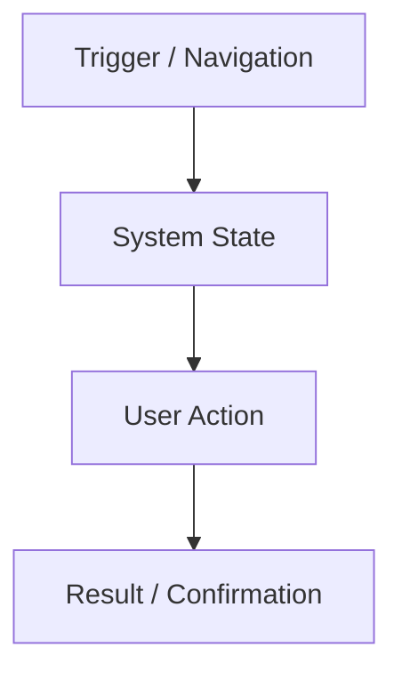

# Feature Specification: [Feature Name]

- **Feature ID**: `FEAT-[NUMBER]`
- **Domain**: [Curriculum | Assessment | Telemetry | Doubts | Analytics | Live | Notifications]
- **Target Release**: [MVP Phase 1 | Phase 2]
- **Author**: `@Product_Agent`
- **Technical Reviewers**: `@Backend_Agent`, `@Frontend_Agent`, `@UX_UI_Agent`
- **Approved by**: `@Education_CTO_Agent`

---

## 1. Feature Overview & Problem Statement
*Describe the pain point being resolved for the teacher or student and the expected business/pedagogical outcome.*

## 2. User Personas & Permissions
- **Primary Actor**: [Teacher | Student | Both]
- **RBAC Policy**: Required roles and authorization permissions.

## 3. Detailed User Workflows

## 4. Functional Requirements
1. The system MUST ...
2. The system MUST NOT ...
3. If X occurs, the system MUST ...

## 5. UI/UX Expectations & Mobile Responsive Guidelines
- Mobile viewport behavior (360px – 420px):
- Desktop view behavior:
- Key interactions, micro-animations, error toasts:

## 6. Data Model & API Touchpoints
- Entities involved:
- Endpoints consumed/exposed:

## 7. Edge Cases & Error Handling
- Network failure during action:
- Duplicate submissions:
- Invalid file types or oversized payloads:

## 8. Acceptance Criteria
- [ ] AC 1
- [ ] AC 2
- [ ] AC 3
